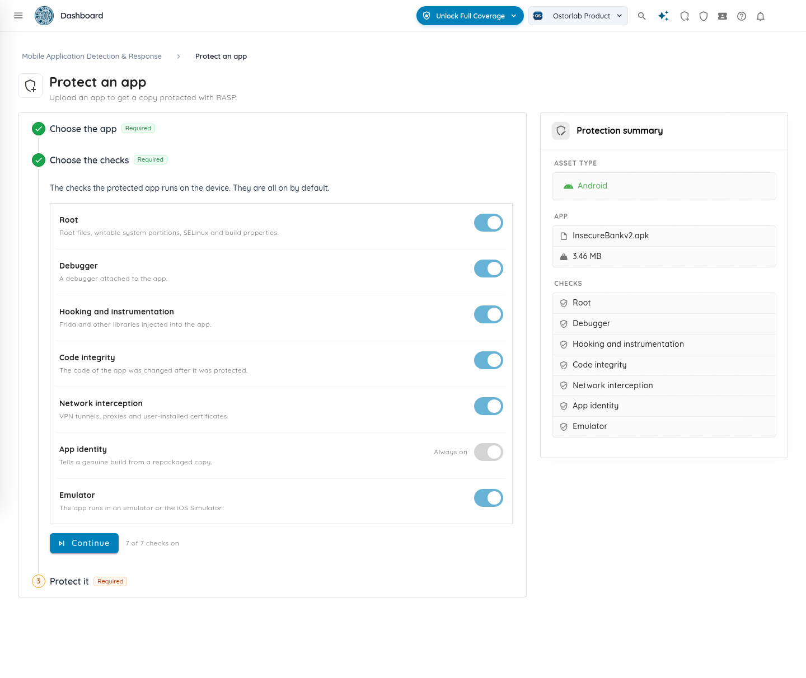
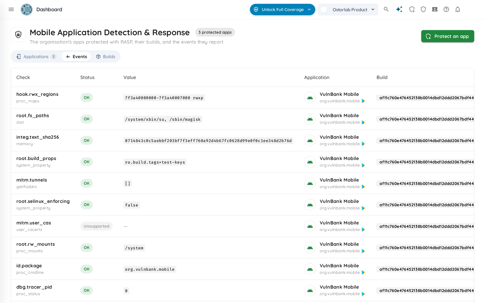
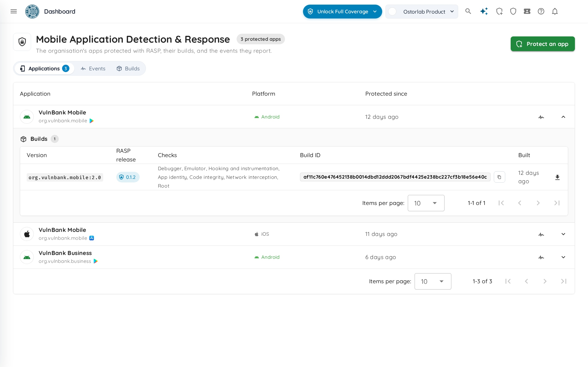

# RASP

[](https://github.com/Ostorlab/rasp/actions/workflows/packer.yml)
[](https://github.com/Ostorlab/rasp/actions/workflows/runtime.yml)
[](LICENSE)

**Runtime application self-protection (RASP) for Android and iOS apps.**

rasp protects an app you have already built. It adds a small runtime to the APK, AAB or IPA, and the protected app
checks the device it runs on and itself while it is in use. No change to the app's source code is needed.

rasp is built from the ground up to resist AI-assisted reverse engineering: there is no key to find, no single check
to patch, and no bypass that carries over from one protected app to the next.

https://github.com/user-attachments/assets/a43d48ed-75ec-43b1-ad76-77fc08826493

## Built to resist AI-assisted reverse engineering

AI tools now read decompiled code, find the line that says "if rooted, exit", and write a Frida script that skips
it, in minutes. Protections that keep a key in the app, or rely on one check that can be patched, fall quickly to
this. rasp was designed against it from the start:

- **No key in the app (Android).** The packer encrypts the app's own classes, and no key is stored. The runtime
  rebuilds the keys on the device from the app and the device itself.
- **Nothing to patch (Android).** A failed check doesn't jump to an exit that can be found and skipped. It changes
  the key instead, so a hooked, debugged or modified app silently fails to decrypt, and the attacker isn't told why.
- **Every app is different (Android).** Each app gets its own random recipe for rebuilding its keys, mixing real
  inputs with decoys. Understanding one protected app doesn't give a script that works on the next one.
- **Obfuscated, and different each release.** Release builds of the runtime are obfuscated with
  [O-MVLL](https://github.com/open-obfuscator/o-mvll) on Android and iOS, with a new secret seed for each release.
- **Checks at random times.** The checks run again at random intervals, not only at start-up, so there is no single
  moment to intercept.

This raises the cost of an attack; it doesn't make one impossible. The known limits are listed in
[`TODO.md`](TODO.md), for example: the decryption code is the same in every app packed from one
release, and a carefully built emulator can still run it.

## Features

- **Android and iOS:** APK, AAB and IPA.
- **No source code changes:** protect the build you already ship.
- **Choose the checks:** pick the check groups that fit your users.
- **Detects:** root and jailbreak, debuggers, Frida and other hooking, emulators, app virtualizers, network
  interception (VPN tunnels and proxies), tampering with the runtime's code, and repackaged copies.
- **Runs all the time:** the checks run when the app starts, then again at random intervals until the app exits.
- **AI-resistant by design:** each protected app is different, so a bypass an AI writes for one app doesn't work on
  another ([details](#built-to-resist-ai-assisted-reverse-engineering)).
- **Events on the Ostorlab platform:** protect apps and see their events in
  [Mobile ADR](#use-adr-on-the-ostorlab-platform) (Mobile Application Detection & Response).

## How it works

```
your app (APK / AAB / IPA)
        │
        ▼
  rasp pack --checks …        adds the runtime and writes the chosen checks into its config
        │
        ▼
protected app (unsigned)  ──▶  you sign it and ship it
        │
        ▼
on the device                  the runtime runs the chosen checks and hands the observations
                               to its plugins; a development build also logs them
```

A plugin is code compiled into the runtime ([API](runtime/core/include/rasp/plugin.h), [example](runtime/plugins/example/)). It can add its own checks, and it receives the observations of each run, for example to send them somewhere. A runtime built without plugins keeps the observations to itself, and a release build doesn't log them.

- **The packer** (`packer/`, Python) adds the runtime to the app and returns it unsigned.
- **The runtime** (`runtime/`, C++) runs inside the protected app and runs the checks.

## Quick start

1. **Install the packer.** Build the runtime first ([details](runtime/README.md#build)), then put `stub.dex` and
   `lib/<abi>/librasp.so` in `packer/src/rasp_packer/android/resources/`, and `RaspRuntime.framework` in
   `packer/src/rasp_packer/ios/resources/`.

   ```
   cd packer
   uv sync --locked
   ```

2. **Protect an app:**

   ```
   uv run rasp pack app.apk --platform android --build-id my-build-1 --checks root,debugger,hooks --output app-protected.apk
   ```

3. **Sign** `app-protected.apk` with your release key, then ship it.

The packer is also a Python library:

```python
import pathlib

from rasp_packer import packer
from rasp_packer import platforms

result = packer.pack(
    app=pathlib.Path("app.ipa"),
    platform=platforms.Platform.IOS,
    output=pathlib.Path("app-protected.ipa"),
    build_id="my-build-1",
    checks=["jailbreak", "debugger", "hooks"],
)
```

## Checks

| Group | Android | iOS | Detects |
|---|:---:|:---:|---|
| `root` | ✓ | | Root files, writable system partitions, SELinux and build properties |
| `jailbreak` | | ✓ | Jailbreak files, sandbox escape and process spawning |
| `debugger` | ✓ | ✓ | A debugger attached to the app |
| `hooks` | ✓ | ✓ | Frida and other libraries injected into the app |
| `integrity` | ✓ | | The runtime's code changed in memory |
| `mitm` | ✓ | ✓ | VPN tunnels, and proxies on iOS |
| `identity` | ✓ | ✓ | A repackaged copy of the app (always on) |
| `emulator` | ✓ | ✓ | An emulator or the iOS Simulator |
| `virtualizer` | | ✓ | The app running inside another app's container |

- Pass the groups with `--checks` (or `checks=` in Python). `identity` is always added.
- An unknown group is skipped with a warning, so a list written for an older version still packs.
- Without `--checks`, only `identity` is chosen.
- Some checks also run when the app starts, whatever the choice.

## Requirements

| | |
|---|---|
| Protected Android app | Android 12 (API 31) or later |
| Protected iOS app | iOS 12.0 or later |
| Packer | Python 3.14, [uv](https://docs.astral.sh/uv/) |
| Runtime build | CMake 4.4, Clang from LLVM 23; the Android NDK, SDK and a JDK for Android; Xcode on a Mac for iOS |

## Documentation

- [`packer/README.md`](packer/README.md): the packer and its options.
- [`runtime/README.md`](runtime/README.md): building and testing the runtime.
- [`TODO.md`](TODO.md): known work that isn't done yet.

## Use ADR on the Ostorlab platform

Don't want to build the runtime yourself, or want to see what your protected apps find on real devices? Mobile ADR
(Mobile Application Detection & Response) on the [Ostorlab platform](https://report.ostorlab.co) protects your
apps with rasp and shows their events:

1. Create an account on the [Ostorlab platform](https://report.ostorlab.co) and open **Mobile ADR**.
2. Upload your APK or IPA, choose the checks, and download the protected app
   ([Protect an app](https://docs.ostorlab.co/mobile_adr/protect_an_app.html)).

   
3. Sign it and ship it as usual.
4. See the events in the **Events** tab: each check run on a device, what it found (root files, Frida, a VPN
   tunnel…), and whether the check could run ([Events](https://docs.ostorlab.co/mobile_adr/events.html)).

   
5. Find every protected version of your app, with its checks and RASP release
   ([Applications and builds](https://docs.ostorlab.co/mobile_adr/applications_and_builds.html)).

   

## Contributing

Contributions are welcome: see [`CONTRIBUTING.md`](CONTRIBUTING.md).

## Security

Please don't report a vulnerability in a public issue. See [`SECURITY.md`](SECURITY.md).

## License

[Apache-2.0](LICENSE)
