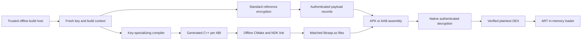

# Offline white-box implementation design

Status: implementation proposal for a research candidate, not a production security claim.
Repository baseline: `a37ef4d`. Constraints: software only, fully offline execution, Android APK and AAB integration.

Build a key-specializing compiler, a native authenticated-decryption implementation, and an attack evaluation harness. First establish a reproducible reference format and correctness oracle; then reproduce published countermeasures before designing stronger ones. Production integration depends on measured correctness, attack resistance, and mobile performance.

The design's central invariant is that a protected implementation must not hand a recovered raw key to an ordinary cipher. Its security claim concerns the entire compiled computation, including initialization, randomness, authentication, and the consumer boundary.

## 1. Security objectives and limits

Assume the evaluator has the APK, native libraries for every shipped ABI, the generator design, arbitrary chosen inputs, instruction and memory traces, process snapshots, control of randomness and system calls, and the ability to patch instructions. Supply known-key examples and reserve independent keys and build seeds for held-out challenges.

| Objective | Success criterion | Limit |
|---|---|---|
| Key extraction resistance | Report the least measured work to recover the challenge key | AES key length is not a white-box security estimate |
| Extraction of a compact decryptor | Report effort and resulting artifact size/dependencies | Copying the complete offline application remains possible |
| Resistance to a reusable unpacker | Measure transfer to unseen builds and ABIs | Diversification may offer no benefit against generic attacks |
| Protected application logic | Measure recovered code and analyst effort separately | Ordinary DEX handed to ART is observable plaintext |
| Integrity in normal execution | Reject malformed or unauthenticated records without serving plaintext | Local verification can be patched by a controlling attacker |

Offline state, public package identifiers, clock values, device properties, and APK signing certificates are not independent secrets. This design claims neither reliable offline revocation nor resistance to whole-device snapshot rollback. Hardware and server contributions are excluded.

## 2. Selected approach and alternatives

Use a native Boolean-circuit compiler with a published masking/shuffling backend as the primary research route. This exposes a precise intermediate representation to correctness checks and attack tools and allows the final native implementation to be measured.

Traditional encoded lookup tables remain an attack baseline: they are straightforward to implement, but table size and opaque encodings alone do not establish resistance to trace analysis. A dedicated space-hard cipher is a separate comparison candidate only if its memory costs and explicitly narrower security goals fit the product. Do not combine three speculative constructions into the first implementation.

The first baseline primitive is AES-128, with AES-128-GCM for payload records: a 16-byte key, 12-byte nonce, and full 16-byte tag. AES-128 is selected for manageable circuit size and comparison with published work. It is not claimed to be stronger than the current ChaCha20-Poly1305, nor to provide 128-bit white-box security. Follow [FIPS 197](https://csrc.nist.gov/pubs/fips/197/final) and [SP 800-38D](https://csrc.nist.gov/pubs/sp/800/38/d/final) exactly.

## 3. Current repository integration points

| Existing path | Current behavior | Experimental integration |
|---|---|---|
| `packer/src/rasp_packer/android/packer.py` | APK/AAB paths create a key and write `key.bin` | Select a matched experimental bundle before encrypting; omit the key entry |
| `packer/src/rasp_packer/android/cipher.py` | Standard ChaCha20-Poly1305 reference | Keep legacy behavior; experimental reference lives in the research package |
| `packer/src/rasp_packer/android/resources.py` | `Artifacts` carries stub and ABI-to-library bytes | Reuse this container for generated libraries |
| `packer/src/rasp_packer/android/runtime_library.py` | Patches `.rasp_config` | Preserve patching; verify experimental build metadata before patching |
| `runtime/android/src/loader/loader.cpp` | Reads the raw key during installation | Experimental build opens the store without a key parameter |
| `runtime/android/src/payload/dex_store.h` | Stores the key for future decryptions | Experimental store retains APK path and payload identities only |
| `runtime/android/src/payload/cipher.cpp` | Imports key into PSA and returns plaintext | Keep legacy implementation in legacy builds; experimental builds link generated decryption |
| `runtime/android/CMakeLists.txt` | Links a generic prebuilt runtime | Add an explicit experimental generated-source input |
| `runtime/tests/CMakeLists.txt` | Tests cipher/store against packer frames | Add cross-language v2 fixture and parser tests |
| `packer/src/rasp_packer/protection_versions.py` | Android version currently 1 | Increment only when protected app behavior changes, not for this design |

`runtime/CONTRIBUTING.md` currently requires library-provided ChaCha20-Poly1305 and prohibits custom payload crypto. The requested custom implementation requires an explicit documented exception for an experimental target at integration time. Retain the ordinary runtime's policy; an experimental target is not evidence that the production policy should change.

## 4. Build and runtime boundaries



Generate a fresh independent AES key, 16-byte build ID, 8-byte nonce prefix, and 32-byte diversification seed for each build transaction. Keep the diversification seed and raw key on the build host. Public build ID is correlation metadata, not a security factor. Restart an interrupted build with a fresh context; do not resume encryption under a reused key/nonce context.

The initial profile uses one payload key per build, shared by all included ABIs because their payload ciphertext is shared. Each ABI receives independently diversified code. An extraction on x86 compromises that build's arm64 payload too: acceptance is determined by the weakest included ABI. Per-component keys are a later measurable experiment, not an initial requirement or a substitute for key protection.

Before normal packing starts, a research driver produces a matched bundle containing the build identity, generated libraries, reference sealer, compiler manifest, and applicable payload limits. The packer consumes this bundle as one transaction. Separately supplied keys and native libraries are rejected. Never pass the key on command lines or emit it in build logs.

The new build step is offline source compilation using the checked-out runtime and locally provisioned NDK/CMake dependencies. Reuse runtime plugins, loader DEX generation, visibility rules, and config embedding. The research driver explicitly requires this SDK; normal packer users do not acquire an NDK dependency. Cache by full compiler/runtime/toolchain revision, ABI, public build ID, and artifact hashes. Treat generated sources, object files, debug maps, and compiler intermediates as sensitive build artifacts.

No dynamic code generation, executable downloads, writable executable memory, or release export of a generic AES primitive is required. Generated code is linked into `librasp.so`; `JNI_OnLoad` remains the only permitted runtime export.

## 5. Compiler architecture

Create a separate `whitebox/` Python project, import package `rasp_whitebox`, using the packer's Python version and lint/type conventions. Keep research dependencies out of the shipping packer until integration is accepted.

| Proposed file under `whitebox/src/rasp_whitebox/` | Responsibility |
|---|---|
| `frame.py` | Canonical v2 header, strict parsing, standard AEAD reference and fresh build context |
| `ir.py` | Immutable, topologically ordered bit-level circuit nodes and validation |
| `aes.py` | Exact AES-128 circuit and compiler-side key expansion |
| `gcm.py` | GCM composition, counter arithmetic, length encoding and tag validation |
| `reference.py` | Circuit evaluation and optional complete intermediate traces |
| `masking.py` | Published masking/shuffling transformations and gadget tests |
| `specialize.py` | Incorporate a build's key into the protected representation |
| `diversify.py` | Validated representation and scheduling transformations |
| `emit.py` | C++23 source emission and private node-to-code map |
| `compile.py` | Orchestrate passes and return artifact paths and resource bounds |
| `build.py` | Offline CMake/NDK subprocesses with checked exit status and bounded logs |
| `evaluate.py` | Reproducible experiment manifests and attack result collection |

Every source module has its corresponding `whitebox/tests/rasp_whitebox/<module>_test.py`. Add modules when their phase begins, rather than creating empty scaffolding for the entire table.

The IR has only input bits, Boolean constants, XOR, AND, NOT, and explicit randomness inputs. Byte permutations and rotations are wiring; public counters are outside the secret arithmetic where possible. Node IDs increase topologically, references must point backwards, input/output counts are explicit, and arithmetic semantics are fixed. Initial limits are 20 million nodes and 2 GiB compiler memory; reject oversized candidates with a resource error.

Before protection, use an algebraic AES S-box implementation over the standard field, rather than secret-indexed lookup operations. Validate the S-box exhaustively over its 256 inputs, test the AES key schedule and full known-answer vectors, then compare generated ciphertext to an independent library. A slow transparent circuit is acceptable for this correctness stage.

Compiler sequence:

1. Construct and verify an ordinary AES/GCM circuit with explicit secret inputs.
2. Apply the selected published protection transformation while the secret inputs remain symbolic.
3. Specialize those inputs into the backend's protected representation. Do not simply emit the key, or a raw expanded schedule, as a C++ array.
4. Include initialization, input encoding, randomness management, tag computation and output decoding in the candidate's attack surface. A runtime `encode(raw_key)` function is an automatic rejection.
5. Diversify within verified transformation rules. Test keys shared across different variants as well as independent-key variants.
6. Emit bounded functions and scratch layouts, compile, validate equivalence again, and run attacks on the resulting binary.

Research parameter sweep: 2, 3, and 4 linear shares crossed with 2, 4, and 8 dummy slots. These are experiment parameters, not assigned security levels. Measure costs before selecting a shipping profile.

## 6. Masking and active attack research

The candidate backend is based on the S5 paper, or its explicitly analyzed composition of dummy shuffling followed by ISW masking. Preserve the published order and exact gadget requirements. The paper's claims concern defined algebraic/correlation/filtering properties; they do not establish security of this loader. Reproduce reduced examples before expanding to AES. [S5, ePrint 2025/171, revision dated 2025-08-13](https://eprint.iacr.org/2025/171)

The S5 repository linked by the paper (`https://github.com/S5white-box/code`) returned 404 during design verification. Do not build against that unavailable dependency or claim its examples were reproduced. The backend phase starts by obtaining and pinning the full paper revision, documenting the mathematical gadgets, and independently implementing their test vectors. If that cannot be completed, the backend phase remains blocked; the reference format and attack infrastructure remain useful.

Three questions determine whether this becomes a credible candidate:

- Can specialization and initialization avoid an easily recovered key while preserving the claimed representation properties?
- Does the construction retain useful resistance when randomness is observed, fixed, replayed, or faulted?
- What remains protected under adaptive faults and patched output checks?

These are research obligations with pass/fail experiments, not assumed properties. An OS RNG supplies functional randomness in normal execution, but its outputs are observable in the attack model. No security claim may assume that calling an RNG creates a private channel. Never fall back to zero or repeated randomness after a functional RNG error.

Use the [Haystack framework, ePrint 2025/1635, revised 2026-04-14](https://eprint.iacr.org/2025/1635) to distinguish trace-based and active-fault properties. Experiments with redundancy and encoded consistency information must state the covered fault model. Repeating a computation and comparing results is only a fault-detection baseline; arbitrary patch resistance is not implied.

## 7. Authenticated record format

All integer fields are unsigned, big-endian. The 64-byte header is `>8sHH16sIQQ12sI`; authenticate its exact bytes as GCM associated data. Append ciphertext of exactly `plaintext_length` bytes and a 16-byte tag.

| Offset | Size | Field | Required value |
|---:|---:|---|---|
| 0 | 8 | magic | ASCII `RASPWBOX` |
| 8 | 2 | version | 2 |
| 10 | 2 | algorithm | 1 = experimental AES-128-GCM |
| 12 | 16 | build ID | Matches the generated runtime |
| 28 | 4 | payload ID | 0 for the class map, 1..65535 for DEX payloads |
| 32 | 8 | plaintext length | Within the payload-specific limit |
| 40 | 8 | ciphertext length | Exactly plaintext length |
| 48 | 12 | nonce | Build nonce prefix followed by payload ID as u32 big-endian |
| 60 | 4 | flags | Zero; unknown flags rejected |

Limits: class map at most 4 MiB; each DEX at most 16 MiB; at most 65,535 DEX entries. These are initial resource limits, not existing product capabilities. The packer rejects larger inputs before compilation, rather than silently truncating or switching algorithms. Each payload is one authenticated record in v2; chunking is excluded to avoid a second ordering/truncation protocol in the first candidate.

Reserve payload ID 0 for `assets/rasp/map.bin`. Assign IDs 1 upward to the distinct DEX paths sorted by their ASCII bytes. Paths must match `business/[0-9]+.dex`; reject duplicate paths in the packer. Reuse the existing class-map text format (`class,path` per line). On the experimental runtime, strictly validate every line, reject duplicate class names, and derive the same sorted distinct path-to-ID mapping after authenticating the map. Multiple different classes referencing one DEX are valid. Do not use the legacy parser's skip-malformed-lines behavior for v2.

Expected payload ID comes from that authenticated mapping, not from a caller-controlled header. Validate magic, version, algorithm, flags, build ID, nonce prefix, expected payload ID, bounded length, equal lengths, and exact total record size before allocations. Never reinterpret the buffer as a packed C++ struct or trust native endianness.

The builder permits one encryption per payload ID in a context. It reserves the ID before encryption and rejects reuse even if encryption fails. Create a fresh key/context for retries of an entire transaction. Copying the same completed ciphertext to each ABI is fine; encrypting changed plaintext under the same key and nonce is not. Same-build replay of an existing valid record is not prevented, and rollback prevention is outside this offline design.

## 8. Runtime API and memory behavior

The internal interface has no key parameter. Proposed contract, with declarations completed in the integration phase:

```cpp
enum class DecryptStatus : std::uint8_t {
  kOk,
  kInvalidFrame,
  kAuthenticationFailed,
  kInsufficientBuffer,
  kRandomnessUnavailable,
};

[[nodiscard]] DecryptStatus decrypt_payload(
    std::uint32_t expected_payload_id,
    std::span<const std::uint8_t> frame,
    std::span<std::uint8_t> plaintext,
    std::span<std::uint8_t> scratch) noexcept;
```

The generated build descriptor provides immutable build ID, nonce prefix, format version, and scratch size. A bounded parser obtains the needed output length before allocation. Output must have exactly that length, scratch at least the declared size, and buffers must not overlap. Scratch has a proposed maximum of 32 MiB per active decryption. Use caller-owned storage; no mutable global crypto state, recursion, exceptions, RTTI, or functions with more than 4 KiB stack usage. The wrapper allocates large buffers through checked non-throwing allocation and returns a loading error on allocation failure; a size cap alone does not make allocation infallible. Propagate Java allocation exceptions through the existing JNI error path.

Authenticate first, then decrypt the immutable ciphertext snapshot. The release path has no generic AES block-output API and no raw GHASH key output. AES state and secret GHASH material remain in the backend's representation until the defined public outputs. Merely protecting AES while exporting its GCM authentication subkey is not the complete candidate. The raw AES entry point exists only in a separate laboratory target.

On failure, return a status and make no plaintext available to the loader. Clear any written output and used scratch through a compiler-resistant clearing helper. Reject oversized archive entries before copying them: add a bounded read overload to `runtime/android/src/apk/archive.*`, since the current archive reader copies an entry after mapping the APK. Work from an owned snapshot to avoid a normal-execution race between authentication and decryption of file-backed bytes.

In the loader, translate failure into the existing class-loading error path. Framework classes may use the base loader, but a protected class must never silently fall back to an unprotected copy after authentication failure. No process termination, signals, telemetry, or release logging is added.

Thread safety follows the existing per-DEX loading locks. Add a bounded permit pool for expensive white-box decryptions (initial capacity 2); size the heap budget for two scratch areas plus input/output buffers. Waiting occurs only in the synchronous class-loading path that already needs the payload; benchmark launch impact. Return all permits and buffers on every error. Release the crypto permit and scratch before invoking ART or Java code, which may recursively request other classes; never hold the global loader-map mutex while waiting for a permit. Immutable generated data is shared; scratch and random streams are per call. Test overlapping requests and independent DEX loads under TSan.

ART still receives plaintext DEX bytes. This implementation makes no stronger claim about that boundary. A protected interpreter for selected business functions is a separate project requiring language/runtime compatibility work and devirtualization evaluation; it is not a hidden dependency of this cipher implementation.

## 9. Compiler and packaging validation

Keep ordinary optimization before masking where equivalence is known. Once protected, use an allowlist of transformations. Initially disable LTO for generated units and evaluate optimization settings separately. Neither `volatile` nor disabled optimization is a proof that masking survives compilation. Record compiler flags, inspect emitted code, and attack the shipped build configuration.

No trace hooks or secret debug maps are linked into release targets. Laboratory targets must trace boundary operations and randomness as well as the core circuit; collecting only favorable nodes invalidates the evaluation. Use an external instruction-level tracer on optimized native binaries as a second observation path.

Generate all required ABI libraries before producing an output APK/AAB. The packer checks their embedded descriptors for consistent version, algorithm, build ID, nonce prefix and profile; a host known-answer test binds the build key to the compiler output. Perform equivalent checks on each ABI through its execution harness. Publish the archive atomically only after all validations succeed; preserve an existing output on failure.

APK and AAB must both omit `assets/rasp/key.bin` (or `base/assets/rasp/key.bin`) in experimental mode. Preserve stub injection, config section patching, minSdk 31, signature removal rules, and unsigned output. AAB bundle splitting must retain the matched assets/runtime pair; test a resulting installed APK set, not only the AAB ZIP.

Use compile-time mode selection. An experimental runtime rejects legacy records; a legacy runtime rejects v2. No format sniffing followed by insecure fallback. The first research interface is a developer-only packing driver, not a new default CLI option. Ship no production feature flag until acceptance gates are met.

## 10. Evaluation and evidence

Collect separate correctness, performance, and attack results. Every result records candidate hash, generator revision, compiler/runtime/toolchain versions, ABI, device, parameters, inputs, build seed identifier, randomness mode, CPU time, peak memory, and outcome. Keep challenge keys and sensitive replay seeds in evaluator-only artifacts; normal reports contain identifiers and hashes.

| Evaluation | Required controls and outcome |
|---|---|
| Correctness | AES/GCM known-answer vectors, empty/partial blocks, independent library comparisons, wrong tag, AAD/header mutations, maximum lengths |
| Parser | Every truncated length, unknown flags/algorithm, unequal lengths, overflow, payload swaps, wrong build, duplicate map classes and malformed paths |
| Trace attacks | DCA, higher-order correlation, linear/algebraic decoding, filtering, chosen-input filtering, node/window sweeps including boundaries |
| Active attacks | Fixed/repeated/observed RNG, forced intermediate values, instruction skips, patched checks, initialization/output faults, snapshot replay |
| Practical extraction | Key recovery, standalone decryptor extraction, complete DEX capture, reusable unpacker transfer, cross-ABI transfer |
| Native behavior | Same tests on optimized emitted binaries; allocator/stack budgets, concurrency, ASan/UBSan/TSan, ABI behavior |

Positive controls must actually break: an ordinary implementation with a raw key, an unprotected traceable circuit, and a published vulnerable masked example. Negative controls must detect intentionally corrupted records. Failing to recover a control key invalidates the attack setup, rather than counting as candidate success.

Use development instances for tuning and a separately sampled held-out set of at least 100 key/seed pairs for transfer measurement. This sample count is an experimental design choice, not a security bound. Publish attack budgets and any failures individually. A time-limited unsuccessful attack is reported as "not recovered within this budget", never converted into bits of security.

Initially target added native size at most 8 MiB per ABI, at most 32 MiB scratch per call, and p95 added decryption latency at most 100 ms for a 1 MiB DEX on a declared reference Android device. Measure the map and actual cold-start path separately. These are proposed product budgets, not achieved measurements. If they cannot be met, report the result and reconsider scope; do not silently weaken the construction or substitute an ordinary raw-key cipher.

For external evaluation, supply the design and known-key examples, then blind challenge keys. Compare against named alternatives under matched CPU, memory, binary-size and functionality budgets. Superiority over unspecified "industry" implementations is not an acceptance criterion.

## 11. Implementation stages and stop conditions

| Stage | Concrete deliverable | Gate before the next stage |
|---|---|---|
| M0 | Canonical frame codec, reference sealer/opener, mutation tests | Exact format and nonce rules verified; no production imports |
| M1 | AES/GCM IR, evaluator, trace format, trivial key-recovery control | Independent known-answer equivalence and a working control attack |
| M2 | Reproduced published masking/shuffling backend | Gadget correctness and stated model properties reproduced; initialization documented |
| M3 | Key specialization, diversification and native emitter | No raw-key handoff; complete native traces and cross-variant equivalence |
| M4 | Active-attack experiments and held-out evaluation | Explicit results for boundary/RNG/fault attacks; no unsupported security labels |
| M5 | Experimental APK/AAB integration across selected ABIs | All included ABIs, installed splits, error paths and latency pass |
| M6 | Independent evaluation and a product decision | Documented evidence and tradeoffs justify a shipping profile |

M2-M4 are research gates: a candidate can be rejected outright. Do not fill an unsuccessful gate with an invented masking gadget. M5's entry requires an explicit decision on the remaining attack limitations; passing functional tests alone is insufficient.

The detailed first implementation plan is [the M0 plan](../plans/2026-11-02-whitebox-foundation.md). It produces a useful correctness contract without pretending that the research gates have already been solved.

## 12. Verification commands for later code changes

The research package follows the packer tool versions and check layout. From `whitebox/`, run `uv sync --locked`, `uv run ruff format --check .`, `uv run ruff check .`, `uv run mypy`, and `uv run pytest` once its lockfile exists.

Packer integration must pass the corresponding commands from `packer/`. Native integration must pass the commands in `runtime/CONTRIBUTING.md`, including host, host-asan, host-tsan, clang-format, clang-tidy, and Android release/development builds for every included ABI. Generated code is subject to the same stack, visibility, logging and language checks as hand-written code. Re-run existing iOS checks when shared runtime build files change.

## 13. Research references and reproducibility

- [DCA original paper](https://eprint.iacr.org/2015/753): baseline trace attack motivation.
- [Filtering attacks, ePrint 2024/691](https://eprint.iacr.org/2024/691): required comparison attack; [authors' implementation](https://github.com/cryptolu/whitebox-filtering/tree/1203659a54bf9b52a880ebb9518474aba52a8bea) pinned to `1203659a54bf9b52a880ebb9518474aba52a8bea`.
- [S5, ePrint 2025/171](https://eprint.iacr.org/2025/171): candidate passive countermeasure basis, revision dated 2025-08-13. Obtain full algorithm text before implementation; the linked source repository was unavailable during this design.
- [Haystack, ePrint 2025/1635](https://eprint.iacr.org/2025/1635): model for distinct passive and active claims, revision dated 2026-04-14; [supporting code](https://github.com/cryptolu/HaystackCiphers/tree/0ecf6e47781805e8e03bf8109b8f696cb9b6f917) pinned to `0ecf6e47781805e8e03bf8109b8f696cb9b6f917`.

The references were inspected for design grounding; no attack code or candidate construction was executed as part of this document. Check licensing before vendoring third-party code, pin every imported revision, and distinguish a paper's claim from a property reproduced in this repository.
